<div align="center">

# QuantOA

**A keyboard-first practice game for quant trading online assessments**
(Optiver, SIG, Jane Street and IMC style).

Timed, calculator-free, with negative marking that punishes guessing. Most questions are **generated by code with randomized parameters**, so you never run out of practice.

**[▶ Try it live](https://shaan50.github.io/QuantOA/)** — no install, no account; progress stays in your browser.

[](https://github.com/Shaan50/QuantOA/actions/workflows/deploy.yml)
[](LICENSE)


</div>

---

## Contents

- [Highlights](#highlights)
- [Quick start](#quick-start)
- [Keyboard controls](#keyboard-controls)
- [Game modes](#game-modes)
- [Question categories](#question-categories)
- [Answer checking](#answer-checking)
- [Scoring](#scoring)
- [Adaptive difficulty (Elo)](#adaptive-difficulty-elo)
- [Review Mistakes (spaced repetition)](#review-mistakes-spaced-repetition)
- [Daily Challenge](#daily-challenge)
- [Market Making mode](#market-making-mode)
- [Analytics dashboard](#analytics-dashboard)
- [Architecture](#architecture)
- [Persistence and swapping in a database](#persistence-and-swapping-in-a-database)
- [Testing and correctness](#testing-and-correctness)
- [Design system](#design-system)
- [Project scripts](#project-scripts)
- [Deployment](#deployment)
- [Extending QuantOA](#extending-quantoa)
- [Limitations and future work](#limitations-and-future-work)
- [Screenshot gallery](#screenshot-gallery)
- [License](#license)

---

## Highlights

| | |
|---|---|
| **8 game modes** | OA Simulation (classic 80-in-8 and a chained 4-section "Full OA"), Sprint, Survival, Focus Drill, Zen/Learn, Daily Challenge, Review Mistakes, and an interactive Market Making game |
| **6 categories** | Mental Math, Sequences, Probability & EV, and Arbitrage are fully procedural (33 templates, 33 subcategories). Brainteasers come from a curated bank of 82 and Fermi estimation from a bank of 60 |
| **Exact answers** | Probability, EV and arbitrage answers are computed with BigInt fractions. Every probability template is validated by an independent Monte Carlo simulator in the test suite |
| **Seeded and shareable** | Every session is driven by a seed string. You can replay it, retry it with the same seed, or share a challenge link that encodes the whole configuration |
| **Keyboard-first** | The cursor stays in the answer box. Enter submits, Tab skips, number keys choose multiple-choice options, `?` shows a hint, and Esc quits |
| **Adaptive** | An Elo-style rating per category chooses the next question's difficulty, aiming for about 70% success |
| **Analytics** | Accuracy and speed over time, per-category small multiples, a subcategory × difficulty weak-spots heatmap, personal bests, and session history |
| **No backend** | Progress lives in `localStorage` behind a three-method async storage interface, so a real database can be swapped in later |
| **Tested heavily** | 239 tests: shared invariants, KaTeX render checks for every prompt, Monte Carlo validation, an exhaustive enumeration of all 2.6M poker hands, brute-force counting, and a fuzz pass over about 250,000 generated questions |

**Stack:** React 19, TypeScript, Vite, Tailwind CSS v4, KaTeX, Vitest, and Playwright (used only for the screenshot and smoke-test script).

---

## Quick start

Play it at **https://shaan50.github.io/QuantOA/**, or run it locally:

```bash
npm install
npm run dev          # http://localhost:5173
npm test             # 239 unit tests (Vitest)
npm run typecheck    # tsc -b
npm run lint         # oxlint
npm run build        # production bundle in dist/
```

The app works entirely offline after the first load. There are no API keys, accounts or servers.

---

## Keyboard controls

| Key | Where | Action |
|---|---|---|
| `Enter` | Question | Submit the typed answer |
| `Enter` | Feedback / explanation | Continue to the next question |
| `Tab` | Question | Skip (not allowed in Survival) |
| `1`–`6` | Multiple choice | Select and submit that option |
| `?` | Question with hints | Reveal the next hint (each one costs 25% of the points) |
| `Esc` | Player | Open the quit dialog (`Enter` confirms, `Esc` cancels) |
| `1`–`8` | Home | Jump to a game mode |
| `Enter` | Home | Start the classic 80-in-8 OA |
| `Enter` | Setup screens | Start the configured session |
| `Enter` / `R` / `Esc` | Results | New set / retry the same seed / go home |
| `↵` in Bid, `↵` in Ask | Market Making | Move to the Ask field, then post the quote |

The answer input refocuses itself whenever it loses focus during a question, so you never have to reach for the mouse.

---

## Game modes

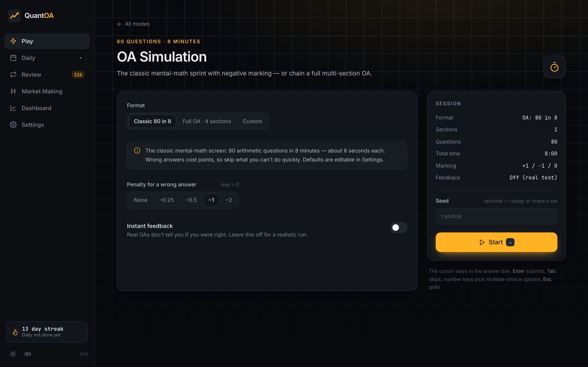

### 1. OA Simulation
- **Classic:** 80 mental-math questions in 8 minutes. The time limit, question count and marking scheme are configurable in Settings.
- **Marking:** +1 for a correct answer, a configurable penalty for a wrong answer (none, −0.25, −0.5, −1 or −2), and a configurable value for a skip.
- **Feedback is off by default**, to match the real test. You can turn on instant feedback.
- **Full OA preset:** four timed sections chained back to back, with a break screen between them:

  | Section | Questions | Time | Difficulty |
  |---|---|---|---|
  | Mental Math | 40 | 6:00 | 1–3 |
  | Sequences | 15 | 6:00 | 2–4 |
  | Probability | 12 | 10:00 | 2–4 |
  | Arbitrage | 8 | 8:00 | 2–4 |

- **Custom:** choose any mix of procedural categories, the time limit and the question count.

### 2. Sprint
Get as many correct answers as you can in **60, 120 or 300 seconds**, in a single category or a mix. Wrong answers cost nothing but time, and the correct answer flashes so you learn as you go.

### 3. Survival
You have **3 lives**. Difficulty starts at 1–3 and rises by one level **every 5 correct answers**. Wrong answers and timeouts cost a life, and skipping is disabled. An optional per-question clock (15, 30 or 60 seconds) makes it harder.

### 4. Focus Drill
Pick categories, then specific **subcategories** within each, and a difficulty: Adaptive, a fixed level 1–5, or mixed 1–5. Choose 10–50 questions, untimed or with a per-question clock. Hints are available for brainteasers.

### 5. Zen / Learn
Untimed and unlimited. After every answer a **full worked solution** appears (rendered with KaTeX), and you press Enter to continue.

### 6. Daily Challenge
Twenty mixed questions seeded by the date, so everyone gets the same set each day. It ramps from warm-up to stretch questions across every category. A **streak counter** tracks consecutive days, and replaying keeps your best score without extending the streak.

### 7. Review Mistakes
Every question you miss in any mode is queued **by template**. Review sessions **regenerate the same template with new numbers**, so you practise the skill rather than memorising an answer. See [spaced repetition](#review-mistakes-spaced-repetition).

### 8. Market Making
An interactive two-sided quoting game. See [Market Making mode](#market-making-mode).

### The player

| Answering | Instant feedback |
|---|---|
| 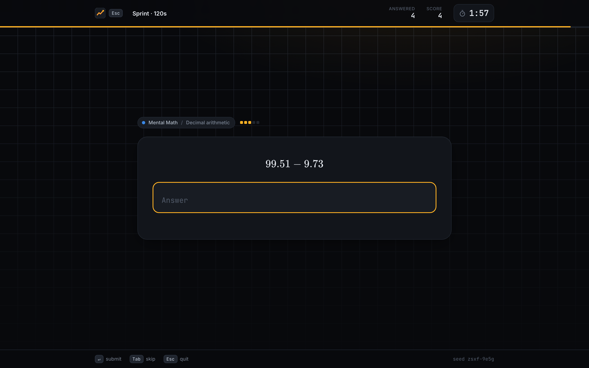 | 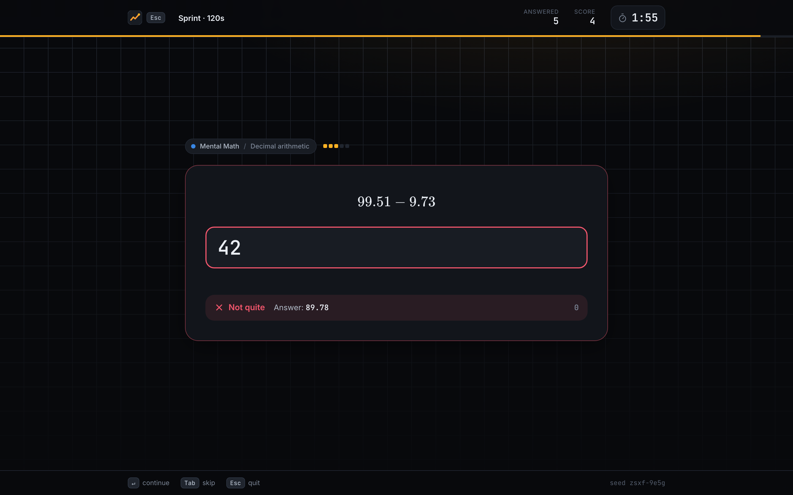 |

- The HUD shows the question count (or the number answered for unlimited modes), the running score, lives in Survival, the level in Survival, and a **countdown that pulses red under 10% remaining**. A thin time bar runs along the top.
- Correct answers flash green. Wrong answers turn red and show the right answer for a configurable time (0.8–3.5 seconds); Enter skips the wait.
- Fermi answers always show the reference breakdown, because the derivation is the point.
- Invalid input (for example `abc`) shakes the box and doesn't use up the question.
- If you close the tab mid-session, everything answered so far is still saved.

### Results

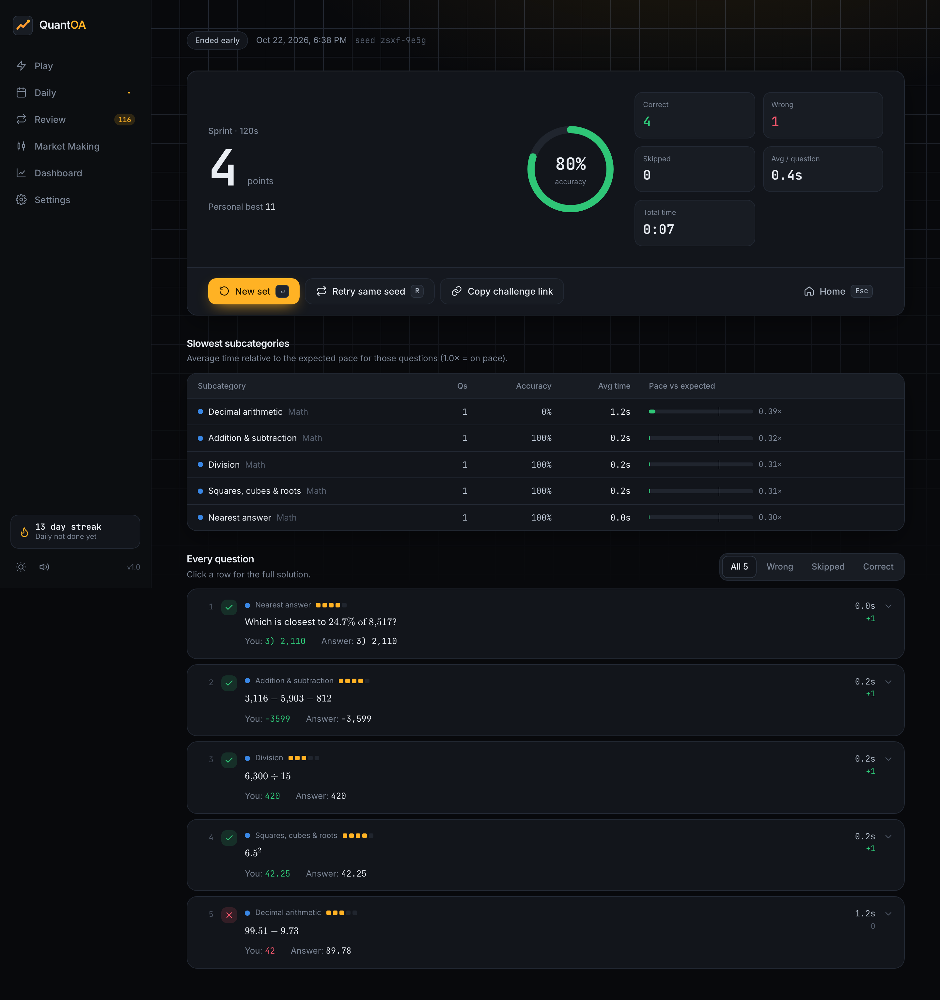

The results screen shows:
- **Score** (with a personal-best banner), an **accuracy ring**, correct, wrong and skipped counts, **average time per question**, and total time.
- **Slowest subcategories:** average time relative to each question's expected solve time, with a pace bar (1.0× means on pace).
- **Every question**, which you can filter to All, Wrong, Skipped or Correct. Each row shows your answer, the correct answer, the time taken and the points, and expands to the full solution.
- Buttons for **New set**, **Retry same seed**, and **Copy challenge link** (a URL with the entire session config encoded).

---

## Question categories

Every question carries an id, category, subcategory, a prompt (with LaTeX), an answer type, a canonical answer and tolerance, solution steps, difficulty (1–5) and an expected solve time. The difficulty pips and subcategory are shown on every question.

### Mental Math: 9 subcategories

| Subcategory | What scales with difficulty |
|---|---|
| Addition & subtraction | 2 → 5 digits, 2 → 4 terms, mixed signs, "ugly" numbers with no trailing zeros |
| Multiplication | 2×1 → 2×2 → 3×2 → 3×3 → 4×3 digits; solutions show place-value splits or round-up compensation |
| Division | Exact integer quotients, then terminating-decimal quotients (÷8, ÷16, ÷125…), then decimal dividends |
| Decimal arithmetic | More decimal places, decimals × decimals, exact decimal division |
| Fractions ↔ decimals ↔ % | Denominators go from halves and quarters → eighths → sixteenths and thirds → 7ths, 9ths and 11ths → 13ths, 17ths and 64ths. Covers fraction→decimal, fraction→%, decimal→fraction and %→fraction |
| Squares, cubes & roots | n² up to 3-digit numbers, cubes, √ and ∛ of perfect powers, 2ⁿ, (n+½)² tricks, √N to one decimal place |
| Percentages | x% of y, % change, reverse percentages, successive changes, "what percent", compound growth |
| Mixed expressions | Order of operations with brackets, squares and negative numbers; every intermediate step is shown |
| **Nearest answer** (multiple choice) | Ugly products and quotients, √N and p% of N. The correct option is within 1/5 of the gap of the true value, and the distractors sit at ±1–3 gaps (gaps shrink from 15% down to 5% as difficulty rises) |

### Sequences: 8 subcategories (find the next term)
Arithmetic · Geometric (integer, negative and fractional ratios such as 3/2 or −2/3, with the start chosen so every term is an integer) · Second differences (quadratic, geometric differences, cubic) · Interleaved (2 or 3 sequences mixing arithmetic and geometric) · Fibonacci-like (sum of the previous two, plus a constant, tribonacci, `aₙ₋₁ + k·aₙ₋₂`, products) · Alternating operations (cycles of +, −, × with period 2 or 3, or growing steps) · Prime-based (pₙ+1, 2pₙ, pₙ², every other prime, running sums, pₙ·pₙ₊₁, prime-indexed primes) · Powers & factorials (squares, cubes, triangular numbers, 2ⁿ−1, n!, nⁿ, n·n!).

### Probability & EV: 11 subcategories, all with exact fractional answers

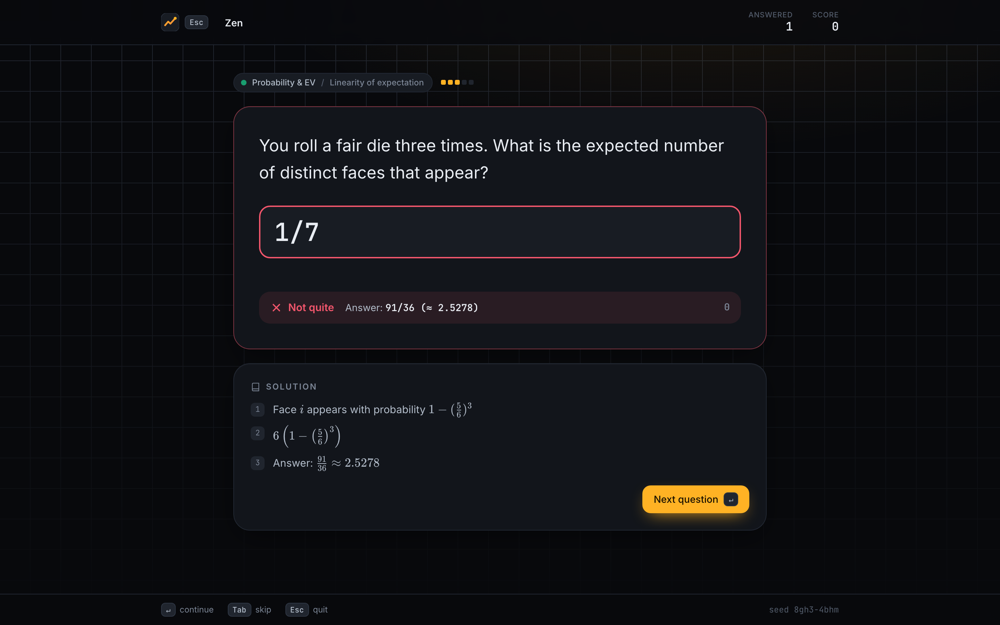

| Subcategory | Examples |
|---|---|
| Dice | P(sum = s) for 2–4 dice via exact convolution, P(sum ≥ s), doubles, all-different, at least one six, max-of-dice, exactly k sixes |
| Coins | Binomial with fair and biased coins, at least k heads, strictly more heads than tails, no two consecutive heads (Fibonacci counting), runs of three heads |
| Cards | Single-card events, two-card events, hypergeometric hands, flushes, one card of each suit, and the poker hand ranks |
| Urns | With and without replacement, hypergeometric, k-th draw symmetry, three colours, "red before green", expected draws to the first red |
| Conditional & Bayes | Two-child problems, dice conditioning, disease testing with one or two positive tests, the double-headed coin, n-door Monty Hall |
| Combinatorics (integer) | Arrangements of words with repeated letters (MISSISSIPPI…), committees, handshakes, lattice paths, "at least one woman", stars and bars, derangements, round-table seating with a constraint |
| Geometric & negative binomial | Expected waits, first success on trial k, more than k trials, r-th success on trial n, expected failures |
| Linearity of expectation | Dice and coin totals, card values, fixed points of a permutation, distinct faces, overlapping HH counts, empty boxes, runs, adjacent mixed pairs, expected cycle count (H_n) |
| Stopping problems | Pattern waiting times (HT, HH, HHH, HTH…, using the self-overlap formula), coupon collector, two sixes in a row (42), sum of rolls until a threshold, Penney's game (Conway's algorithm) |
| Betting games & fair price | Fair price of dice, card and coin games, optimal re-roll games (4.25, 14/3, 89/18), capped St. Petersburg, **"Would you pay $X?"** multiple choice with the price kept at least $0.10 from fair value |
| Variance & std. dev. (difficulty 3+) | Var of a die, binomial, sums of dice, linear combinations, geometric, max of two dice (2555/1296), SD of the number of heads |

### Arbitrage: 5 subcategories, each able to produce a genuine "no arbitrage" case

| Subcategory | Mechanics |
|---|---|
| Triangular FX | Three FX quotes as mids (difficulty 1–3) or bid/ask (4–5). Questions ask for the best round-trip profit on N units, or which route works. Cases are clear-cut: either a real edge above 4bp or clearly no arb, and some cases are "the mid looks like an arb but the spreads kill it" |
| Dutch book | Decimal odds (fractional at difficulty 4–5) on 2–4 outcomes. Asks whether a Dutch book exists, for the guaranteed profit, or for the stake on a given outcome. The book total is never within 1.5% of 1 |
| Put–call parity | Zero rates, then discount factors, then dividends. Asks which side to buy and which to sell (conversion vs reversal vs none) or for the locked-in profit per share or per N contracts |
| Crossed venues | One or two levels per venue, optional per-share fees, and "fee trap" cases that cross by one cent before fees and are flat after them. Asks for the direction or the maximum riskless sweep profit |
| Forward pricing | Simple-interest carry, dividends, storage costs, and FX covered interest parity. Asks for the fair forward, rich / cheap / fair, or the profit at expiry |

### Brainteasers: curated bank of 82
Interview classics with **exactly two progressive hints** and a full solution each, rated 1–5, and covering probability, logic, counting, number sense, and strategy and games. Examples include Monty Hall, the birthday problem, the egg drop (14), the pirate game (98), blue-eyed islanders, hats in a line, the 100 prisoners, the Tuesday boy (13/27), the ant on a cube (10), and the longest piece of a broken stick (11/18). Every answer is auto-gradable as a number, a fraction or multiple choice. **Each hint used reduces the points by 25%.**

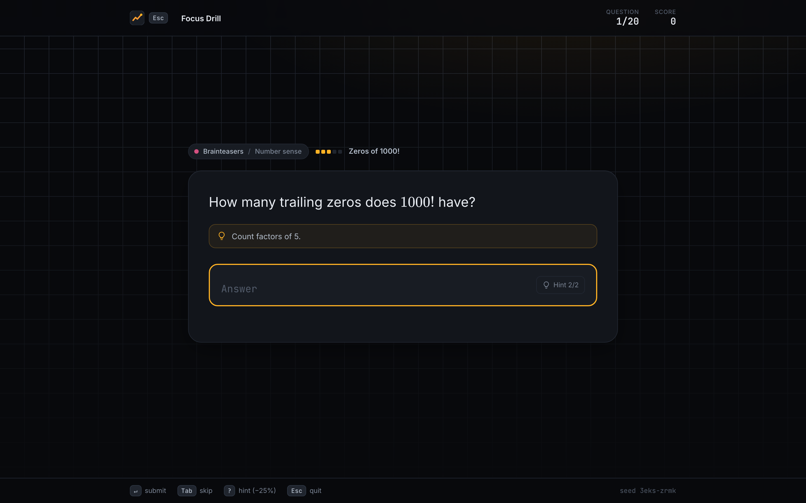

### Fermi estimation: curated bank of 60
Each question has a reference answer and a short derivation whose arithmetic actually lands on that reference. Topics are everyday life, business and population, science and nature, and markets and energy. Answers can be typed as `2.5m`, `40k`, `3e9`, `3 billion` or `2x10^6`. The reference breakdown is always shown after you answer.

---

## Answer checking

One module, `src/core/answer.ts`, handles all parsing and grading.

**Accepted input forms**

| Form | Examples |
|---|---|
| Integers and decimals | `42`, `-17`, `+5`, `.5`, `3.25`, `1,234,567` |
| Fractions and mixed numbers | `3/8`, ` 3 / 8 `, `-3/8`, `6/16` (equivalent forms are reduced), `1 1/2` |
| Percent | `37.5%` (equals 3/8), or `15%` read as 15 when the answer is already in percent units |
| Scientific and suffixed | `1e6`, `2x10^6`, `10^9`, `2.5m`, `40k`, `3 billion`, `1.2bn` |
| Cosmetic characters | `$`, `€`, `≈`, `~`, a unicode minus `−`, and fraction slashes are all ignored or normalised |
| Multiple choice | `2`, `b`, `B)`, the option text itself, or a numerically equal value |

**Grading rules**

- **Integer:** exact match, compared on exact rationals, so `12.0` and `24/2` are accepted.
- **Decimal:** absolute and/or relative tolerance per question (for example 1% relative on arbitrage profits, or ±0.05 on √N to one decimal place).
- **Fraction:** exact rational equality in any form. For a **non-terminating** value such as 1/3, a decimal or percent with **at least 3 significant figures** that is either correctly rounded or truncated is accepted (`0.333`, `0.667`, `0.666`, `33.3%`). `0.33` and `0.334` are rejected. Terminating fractions must be exact. Questions can **require a form**: "convert 0.4375 to a fraction" rejects `0.4375` as invalid rather than wrong.
- **Estimate:** log-scale credit (see below).
- **Invalid input** returns `invalid` with a message, and the question is not used up.

`formatAnswer()` renders canonical answers for display (`26/51 (≈ 0.5098)`, `-$5`, `≈ 2.5 million`), and `canonicalInput()` produces a string the checker is guaranteed to accept. The tests round-trip every generated question through it.

---

## Scoring

- **Marking schemes:** `{ correct, wrong, skip }`. OA mode defaults to +1 / −1 / 0, and the other modes use +1 / 0 / 0.
- **Hints:** points × (1 − 0.25 × hints used).
- **Fermi log scale:** with `ratio = max(guess/ref, ref/guess)`, the credit is:

  | ratio | credit |
  |---|---|
  | ≤ 2× | **1** (full credit) |
  | 2× – 10× | `0.5 · (1 − (ln r − ln 2) / (ln 10 − ln 2))`, which decays linearly in log space from 0.5 to 0 |
  | ≥ 10× | 0 |

  Accuracy statistics count partial credit fractionally. Only full credit counts as "correct".

---

## Adaptive difficulty (Elo)

Each category has a player rating, starting at 1200. Each difficulty level has a fixed question rating:

| Difficulty | 1 | 2 | 3 | 4 | 5 |
|---|---|---|---|---|---|
| Rating | 1000 | 1200 | 1400 | 1600 | 1800 |

- Expected score: `E = 1 / (1 + 10^((Q_d − R) / 400))`
- Update: `R ← R + K · (S − E)`, where S is the credit (0–1). A correct answer in under 60% of the expected time counts as `S = 1.1`. K is 48 for the first 20 attempts, then 32, then 20 after 100.
- **The next question's difficulty** is the level whose expected success is closest to **70%**, with 20% exploration of ±1 level.
- Ratings map to tiers: Novice → Intern → Junior Trader → Trader → Senior Trader → Partner.

Ratings update after every attempt in every mode, so the dashboard always reflects your current level. Turn adaptive difficulty off in Settings to use a fixed level instead.

---

## Review Mistakes (spaced repetition)

A Leitner system, implemented in `src/engine/review.ts`:

- A wrong answer or timeout in any mode puts `templateId:difficulty` in **box 0, due now**.
- A correct review promotes the item to the next box, with intervals of **same day → 1 → 3 → 7 → 14 → 30 days**. Passing the last box **graduates** it out of the queue.
- A wrong review sends the item back to box 0 and increases its lapse count.
- Review sessions take up to 20 due items, weakest boxes first, and **regenerate each template with a fresh seed**.

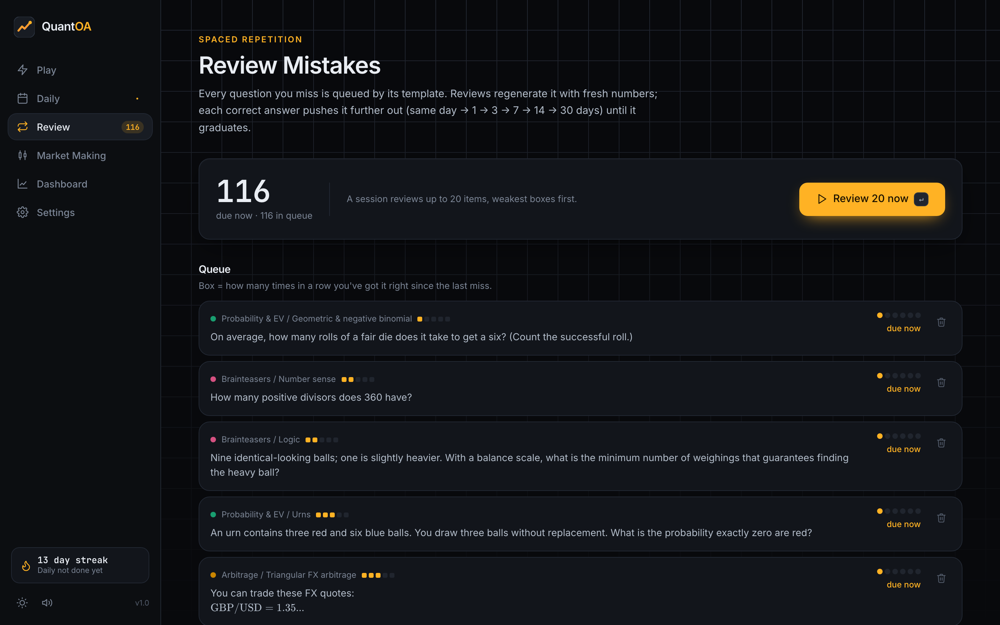

---

## Daily Challenge

- The seed is `daily-YYYY-MM-DD` and the plan is a fixed 20-slot ramp across all six categories. Generation is deterministic, so everyone gets identical questions.
- A streak continues if the previous completion was yesterday. Only the actual day's challenge counts, and replays keep the best score.
- A 5-week calendar heatmap shows completion and score.

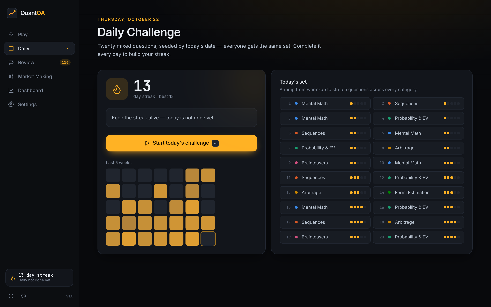

---

## Market Making mode

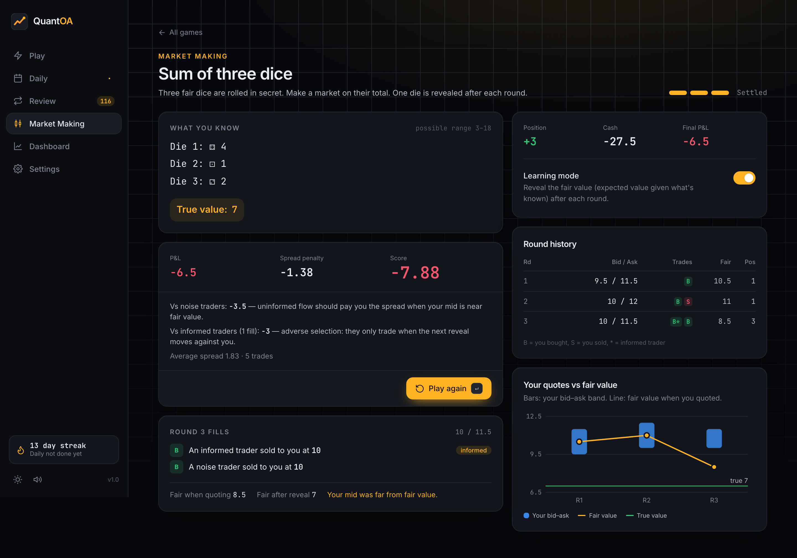

You quote a **bid and ask** (with the spread capped) on a hidden quantity. Simulated counterparties trade against mispriced quotes, more information is revealed between rounds, and every position settles at the true value at the end.

| Scenario | Rounds | Max spread | Information revealed |
|---|---|---|---|
| Sum of three dice | 3 | 2 | One die per round |
| Sum of five cards (A=1…K=13) | 5 | 6 | One card per round (without replacement) |
| Heads in 20 flips | 4 | 3 | Five flips per round |
| Highest of four dice | 4 | 1 | One die per round |
| The hidden number (1–100) | 4 | 10 | A true clue per round (parity, threshold, divisibility, tens digit) |

**Counterparty model:** three traders arrive each round.
- **Noise traders (about 70%)** value the quantity at the current fair value plus Gaussian noise, so they pay the spread to a tight, well-centred quote.
- **Informed traders (about 30%)** already know the next reveal and value it at `E[X | next info]`. They pick off quotes that ignore what's coming, which is adverse selection.

**Fair values are exact conditional expectations.** For example, card sum = revealed sum + remaining cards × (deck total − revealed sum) / cards remaining, and the max of dice is computed as `Σ P(max ≥ v)`.

**Score = P&L − 0.25 × Σ spreads.** This rewards tight markets: a wide quote never trades, but it still pays the penalty.

Learning mode, which is on by default, reveals the fair value after each round, marks your P&L to fair value, and plots your bid–ask bands against the fair-value line. Settlement splits your P&L into what you made from **noise** flow and what you lost to **informed** flow.

---

## Analytics dashboard

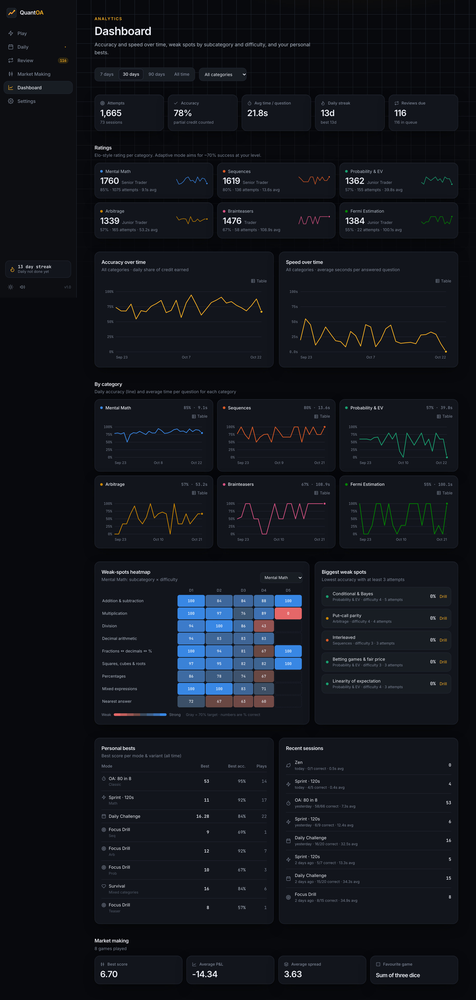

- A single **filter row** (7 / 30 / 90 days / all time, plus a category filter) scopes everything below it.
- **Stat tiles:** attempts, accuracy, average time per question, daily streak (and best), and reviews due.
- **Ratings:** each category's Elo, tier, accuracy and average time, plus a 14-day accuracy sparkline.
- **Accuracy over time** and **speed over time** as two separate single-axis charts, plus **per-category small multiples** rather than six overlapping lines. Each chart has a crosshair tooltip on hover and keyboard focus (arrow keys) and a **Table view**, so no value is hidden behind hover or colour.
- **Weak-spots heatmap:** subcategory × difficulty, on a diverging red ↔ gray ↔ blue scale centred on the 70% target, with the number in every cell and a tooltip.
- **Biggest weak spots:** the five lowest-accuracy cells with at least 3 attempts, each with a one-click "Drill" link.
- **Personal bests** per mode variant (for example `sprint:120:mental-math`), **recent sessions**, and **market-making** summary stats.

Charts are hand-rolled SVG that follows the reference dataviz specs: 2px lines, ≥8px end markers with a surface ring, hairline recessive grids, and a legend for any chart with two or more series. The six category colours are the reference categorical palette, and the validator was run against this app's own dark (`#12151b`) and light surfaces. Both pass every CVD and normal-vision check. In light mode three hues fall below 3:1 contrast against the surface, which is why every chart also offers a table view and direct numbers.

---

## Architecture

```
src/
├── core/                    Framework-agnostic primitives
│   ├── rng.ts               SeededRNG (sfc32 + cyrb128 string hash): int, pick, weighted, shuffle, sample, normal, fork
│   ├── fraction.ts          Exact BigInt rationals: arithmetic, parsing, decimal/LaTeX formatting
│   ├── math.ts              choose, perm, factorial, primes, harmonic numbers, dice-sum convolution, rounding
│   ├── types.ts             Question, Answer, QuestionTemplate, QuestionGenerator, Difficulty, CategoryId
│   ├── answer.ts            The single parse / normalise / check / format module
│   └── mathText.ts          Splits text into plain and $inline$ / $$display$$ LaTeX segments
├── generators/              The core of the product
│   ├── registry.ts          makeGenerator() and runTemplate(): selection, filtering, deterministic replay
│   ├── helpers.ts           Answer builders, LaTeX number formatting, multiple-choice builder (rejects duplicates)
│   ├── mentalMath.ts        9 templates
│   ├── sequences.ts         8 templates
│   ├── probability.ts       11 templates (exact Fractions, meta for Monte Carlo)
│   ├── arbitrage.ts         5 templates (exact money arithmetic on the numbers as displayed)
│   ├── banks.ts             Brainteaser and Fermi banks wrapped as templates
│   └── index.ts             Category registry, labels, template lookup
├── data/
│   ├── brainteasers.ts      82 curated items (2 hints + solution each)
│   └── fermi.ts             60 curated items (reference + derivation)
├── engine/                  Game logic, independent of React
│   ├── session.ts           SessionEngine: phases, timers, sections, lives, ramps, hints, scoring, Elo updates
│   ├── modes.ts             Mode presets → SessionConfig; shareable config encoding
│   ├── scoring.ts           Marking schemes, hint penalty
│   ├── elo.ts               Ratings, difficulty selection, tiers
│   ├── review.ts            Leitner spaced repetition
│   ├── daily.ts             Daily plan, date seeds, streaks
│   ├── results.ts           Session summaries, slowest-subcategory breakdown
│   ├── analytics.ts         Time series, heatmap, weak spots, personal bests
│   ├── marketMaking.ts      Scenarios, counterparty model, MarketGame
│   └── settings.ts          Defaults
├── storage/
│   ├── backend.ts           PersistenceBackend interface + LocalStorageBackend + MemoryBackend
│   └── repository.ts        ProgressRepository: cached reads, write-through, subscriptions, export/import/reset
├── ui/
│   ├── components/          Primitives, KaTeX MathText, SVG charts, icons
│   ├── screens/             Home, Setup, Player, Results, Dashboard, Daily, Review, Market, Settings
│   ├── store.tsx            Repository + active-session React contexts, theme/sound sync
│   ├── sessionFlow.ts       finalizeSession(): persists attempts, ratings, review queue, daily, summary
│   ├── router.ts            Tiny hash router
│   └── sound.ts             Synthesized Web Audio effects (no assets)
└── App.tsx                  Shell, sidebar navigation, routing, shared-link handling
```

### Core interfaces

```ts
interface QuestionGenerator {
  category: CategoryId
  subcategories: readonly SubcategoryInfo[]
  templates: readonly QuestionTemplate[]
  generate(difficulty: Difficulty, rng: SeededRNG, opts?: { subcategories?: string[]; templateId?: string }): Question
}

interface QuestionTemplate {
  id: string                       // e.g. "prob.stopping"
  category: CategoryId
  subcategory: string
  minDifficulty?: Difficulty
  maxDifficulty?: Difficulty
  weight?: number
  generate(difficulty: Difficulty, rng: SeededRNG): QuestionDraft
}

type Answer =
  | { type: 'integer'; value: number }
  | { type: 'decimal'; value: number; tolerance: { abs?: number; rel?: number } }
  | { type: 'fraction'; num: string; den: string; form?: 'fraction' | 'decimal' }
  | { type: 'multiple-choice'; choices: string[]; correctIndex: number }
  | { type: 'estimate'; value: number }
```

### Determinism, replay and sharing
- `runTemplate(template, difficulty, seed)` builds a fresh `SeededRNG(seed)`, so **any question can be reproduced from `(templateId, seed)`**. The question id is `templateId#seed`.
- The session engine generates question *i* of section *s* from `${seed}|s${s}|q${i}`. Sessions with a fixed difficulty are therefore fully reproducible from the seed. Adaptive sessions depend on your answers, because difficulty follows your rating.
- **Copy challenge link** encodes the whole `SessionConfig` as URL-safe base64 in `#/play?c=…`. Opening the link starts the identical session.
- Each setup screen has an optional **seed** field for replaying a specific set.

### Session flow
1. A setup screen builds a `SessionConfig` (`modes.ts`), and `useStartSession()` creates a `SessionEngine` and routes to `#/play`.
2. The Player renders `engine.phase` (`question` → `feedback` → … → `section-break` → `finished`), drives a 10 Hz clock for section and per-question timeouts, and forwards key presses (`submit`, `skip`, `useHint`, `advance`, `quit`).
3. On finish, `finalizeSession()` persists compact `Attempt` records, ratings, the review queue, the daily streak and a `SessionSummary`. It then routes to the results screen.

---

## Persistence and swapping in a database

All persistence goes through a three-method async interface:

```ts
interface PersistenceBackend {
  load<T>(key: string): Promise<T | undefined>
  save<T>(key: string, value: T): Promise<void>
  remove(key: string): Promise<void>
}
```

`ProgressRepository` loads everything once at startup (`init()`). It serves **synchronous reads from an in-memory cache**, so the UI stays simple, writes through to the backend asynchronously and in order, and notifies subscribers so React re-renders via `useSyncExternalStore`.

Stored keys (prefixed `quantoa:` in localStorage):

| Key | Contents |
|---|---|
| `attempts` | Compact analytics log (category, subcategory, template, difficulty, status, credit, time, expected time, timestamp). Capped at 8,000 |
| `sessions` | Session summaries for personal bests and history. Capped at 600 |
| `settings` | User settings, merged with defaults on load (tolerates partial or corrupt data) |
| `ratings` | Elo per category |
| `review` | Spaced-repetition queue |
| `daily` | Streak, best streak, per-day results |
| `market` | Market-making results |

**To use a real database**, implement `PersistenceBackend` (for example with `fetch` calls to a REST API, Supabase or IndexedDB) and pass it in `src/main.tsx`:

```ts
class ApiBackend implements PersistenceBackend {
  async load<T>(key: string) { const r = await fetch(`/api/progress/${key}`); return r.ok ? ((await r.json()) as T) : undefined }
  async save<T>(key: string, value: T) { await fetch(`/api/progress/${key}`, { method: 'PUT', body: JSON.stringify(value) }) }
  async remove(key: string) { await fetch(`/api/progress/${key}`, { method: 'DELETE' }) }
}
const repo = new ProgressRepository(new ApiBackend())
```

Settings → **Export JSON / Import JSON / Reset progress** works with any backend.

---

## Testing and correctness

> "Every generated answer must be mathematically correct."

`npm test` runs **239 tests in 12 files** in about 20 seconds.

| Layer | What's verified |
|---|---|
| **Shared invariants** (`generators/__tests__/harness.ts`) | 100–150 seeds × 5 difficulties for every template: a non-empty prompt and explanation, no `NaN`, `Infinity`, `undefined` or `null` in any text, **every `$…$` segment renders with KaTeX** (`throwOnError: true`), no unbalanced `$`, multiple-choice options distinct with a valid correct index, canonical answer accepted by the checker, and determinism for a fixed seed |
| **Mental math** | Answers equal an **independent evaluator** of the prompt's LaTeX; percentages are recomputed from every phrasing; nearest-answer options are sorted and the correct one is at least 1.5× closer than any distractor; digit counts grow with difficulty; division never divides by zero |
| **Sequences** | Each rule is re-verified through the answer: constant differences or ratios (never 0, ±1), quadratic, cubic or geometric-difference structure, each interleaved sub-sequence, Fibonacci-family recurrences, alternating-operation phases. The tests check that sequences are never constant or accidentally arithmetic |
| **Probability: Monte Carlo** | An **independent simulator for every question kind** (written from the question's `meta`, never reusing generator formulas) runs 40,000 trials. Conditional problems use rejection sampling, and betting games use hand-derived optimal strategies. Estimates must agree with the exact fraction within 5 standard errors |
| **Probability: exhaustive** | Poker-hand counts are checked against an **enumeration of all 2,598,960 hands**. Combinatorics answers are checked by brute force (multiset dynamic programming for words, subset enumeration, lattice dynamic programming, permutation enumeration for derangements and round tables). Pattern-wait, Penney and re-roll helpers are checked against known values |
| **Arbitrage** | FX: brute-force enumeration of both cycles, with every arb at least 4bp. Dutch book: equal-payout stakes reproduce the stated profit in every outcome, and the book is never knife-edge. Put–call parity: the recommended portfolio has a **zero payoff for every terminal price**, and the cash taken in today equals the answer. Venues: a share-by-share sweep, internally sane books, never crossed in both directions. Forwards: cash-and-carry P&L. Every template produces both arb and no-arb cases |
| **Fuzz** | 33 procedural templates × 5 difficulties × 1,500 seeds (**about 250,000 questions**): never throws, no non-finite answers, no duplicate options, canonical answer accepted |
| **Banks** | At least 82 / 60 items, unique ids, exactly two hints each, every difficulty covered, Fermi log scoring, deterministic replay through the registry |
| **Engine** | Marking and hint penalties, Elo convergence, Leitner promotion and graduation, streaks across month boundaries, sessions run to completion, seed reproducibility, invalid input not consumed, negative marking, Full OA section breaks, Survival lives and ramps, timeouts, progressive hints, no duplicate questions, review regenerates with new numbers, config URL round-trip, analytics |
| **Market making** | Every scenario's fair value matches a Monte Carlo conditional expectation at every round and is a martingale; P&L equals Σ (true value − price) × signed size; direction of counterparty trades; quoting at fair value beats a stale quote on average; determinism |
| **Storage** | Persist and reload, subscriptions, the attempt cap, export/import/reset, partial or corrupt stored state |

Two real bugs were caught this way during development: an alternating-operations sequence that collapsed to 0, 0 and a Fibonacci-like start that produced a constant sequence. The second was found by the demo-data generator, which led to the fuzz suite. Generators now retry degenerate draws instead of emitting them.

### Non-degeneracy guarantees
- No division by zero, no constant sequences, no ratio of 0 or ±1.
- No "arb" with zero profit unless the intended answer is "no arbitrage". Marginal cases are rejected and regenerated: FX edges must be above 4bp or below −0.5bp, and Dutch books must be at least 1.5% from 1.
- Multiple-choice builders throw on duplicate options, and the tests prove that never happens.
- "Would you pay $X?" prices are at least $0.10 from fair value.
- Option prices in put–call parity are always at least $1.

---

## Design system

- **Dark by default**, with a light theme (Settings, or the sun/moon toggle in the sidebar). Every colour is a CSS custom property on `:root`, overridden for `[data-theme='light']` and mapped into Tailwind v4 via `@theme inline`.
- **Brand:** amber `#ffb224` with an orange gradient, on near-black surfaces and a subtle trading-terminal grid that fades out down the page.
- **Type:** Inter Variable for the UI and **JetBrains Mono Variable for every number** (`.num`, tabular figures). Both are self-hosted via `@fontsource`, so the app works offline.
- **Status:** green for correct and red for wrong, always paired with an icon and a label, never colour alone.
- **Motion:** rise and pop entrances, a green flash for correct answers, a shake for invalid or wrong choices, and a pulsing red countdown. All of it respects `prefers-reduced-motion` and the Reduce motion setting.
- **Sound:** synthesized blips for correct, wrong, skip, the time warning (at 10% remaining), trades and finishing. They can be toggled anywhere.
- **Responsive:** the sidebar collapses to a scrollable top bar on phones. The screenshot script checks for horizontal overflow at a 390px width.

| Light theme | Mobile |
|---|---|
|  | 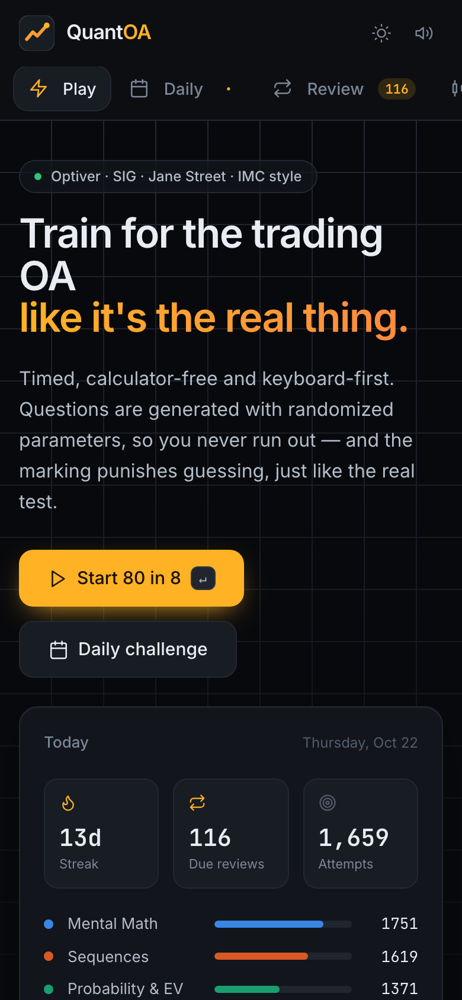 |

---

## Project scripts

| Command | Purpose |
|---|---|
| `npm run dev` | Vite dev server |
| `npm test` / `npm run test:watch` | Vitest |
| `npm run typecheck` | `tsc -b` (strict, including tests) |
| `npm run lint` | oxlint with React hooks and compiler rules |
| `npm run build` / `npm run preview` | Production build and preview |
| `npm run seed:demo` | Runs the **real session engine** with a simulated, improving player over 30 days and writes `demo-progress.json`, which you can load from Settings → Import JSON |
| `npm run screenshots -- demo-progress.json` | Playwright smoke test of all 17 screens (desktop, light theme and mobile). Fails on any page or console error or on mobile horizontal scroll, and writes `docs/screenshots/*.png`. It expects a dev server on port 5199 (`npm run dev -- --port 5199`), or set `BASE_URL` |

In dev builds the player exposes the active engine as `window.__quantoa` so the screenshot script can answer questions. Production builds strip it.

---

## Deployment

The app is a static site, deployed to **GitHub Pages** by [`.github/workflows/deploy.yml`](.github/workflows/deploy.yml):

1. Every push and pull request runs `npm ci`, the linter, the full test suite and the production build on Node 22.
2. Pushes to `main` then upload `dist/` and publish it to https://shaan50.github.io/QuantOA/. A failing test blocks the deploy.

`vite.config.ts` sets `base: './'`, so the same build works at a domain root or under a sub-path, and the hash router (`#/dashboard`) means no server rewrites are needed. Any static host (Netlify, Vercel, S3, `npx serve dist`) works too.

One-time setup on a fork: **Settings → Pages → Source: GitHub Actions**.

---

## Extending QuantOA

**Add a procedural template:**
1. Write a `QuestionTemplate` in the relevant generator file. Return a `QuestionDraft` with the prompt (LaTeX in `$…$`, literal dollars as `\$`), an answer (`intAnswer` / `decAnswer` / `fracAnswer` / `mcAnswer`), explanation steps, `expectedSeconds`, and `meta` holding the parameters.
2. Add it to the category's template array and, if it's new, to the subcategory list.
3. The shared harness and fuzz suites pick it up automatically. Add an independent check (a simulator or brute force) in the category's test file.

**Add a brainteaser or Fermi question:** append to `src/data/brainteasers.ts` (two hints required) or `src/data/fermi.ts` (make sure the derivation arithmetic lands on the reference). The bank tests validate it.

**Add a game mode:** build a `SessionConfig` factory in `engine/modes.ts`. The `SessionEngine` already supports sections, time limits, per-question clocks, lives, difficulty ramps, fixed question lists, hints and skip rules.

---

## Limitations and future work

- Progress is per-browser until you plug in a backend. Use Export JSON to move between machines.
- Fermi reference values are order-of-magnitude estimates from commonly cited mid-2020s figures, and the scoring band (full credit within 2×) reflects that.
- Adaptive sessions are reproducible from a seed only if the answers are identical.
- Possible next steps: a server-backed leaderboard for the Daily Challenge, more market-making scenarios with multi-lot sizes and inventory limits, a PWA/offline install, and timed per-section analytics for the Full OA.

---

## Screenshot gallery

| | |
|---|---|
|  Home |  OA setup |
|  Player |  Wrong-answer feedback |
|  Zen explanation |  Brainteaser hint |
| 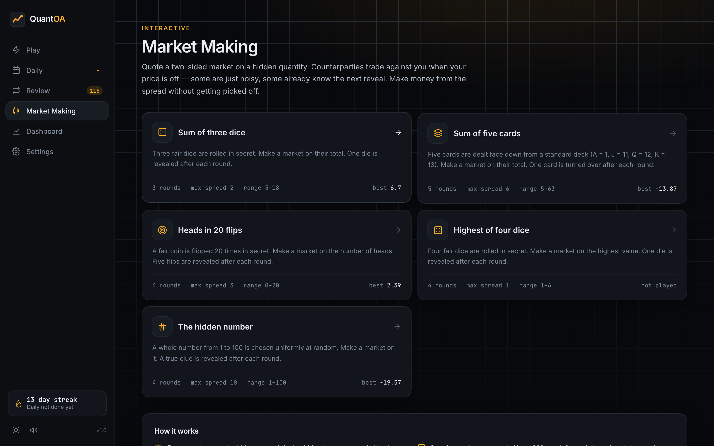 Market making games | 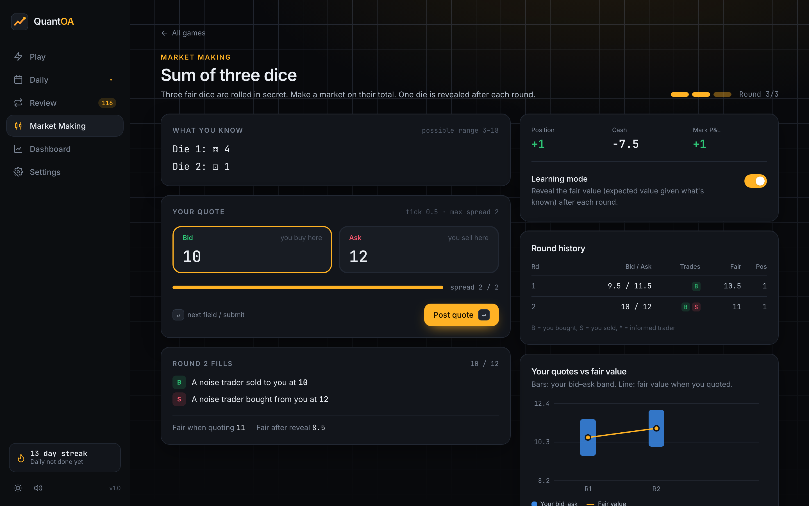 Mid-game |
|  Daily Challenge | 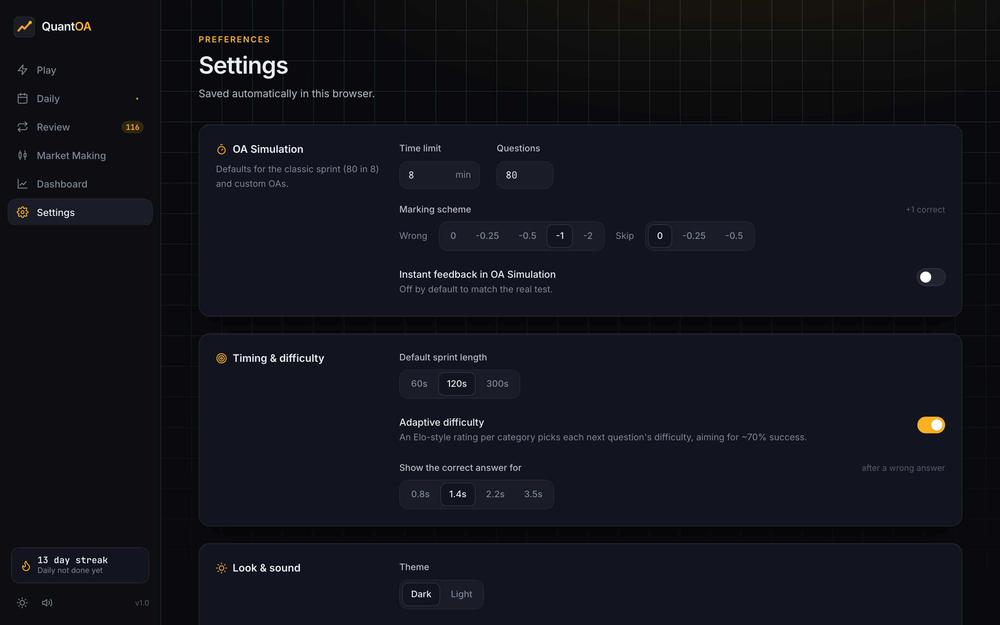 Settings |
| 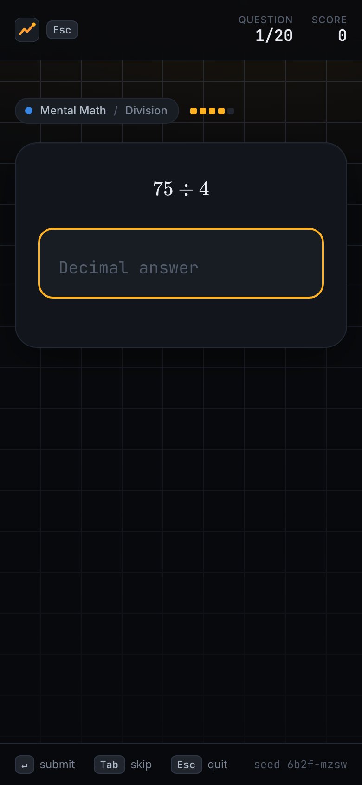 Mobile player |  Review queue |

---

## License

[MIT](LICENSE) © 2026 Shaan Cheruvu
